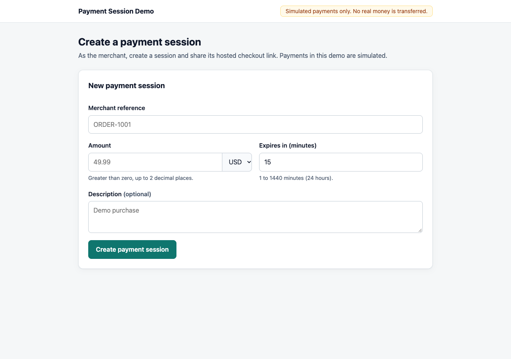
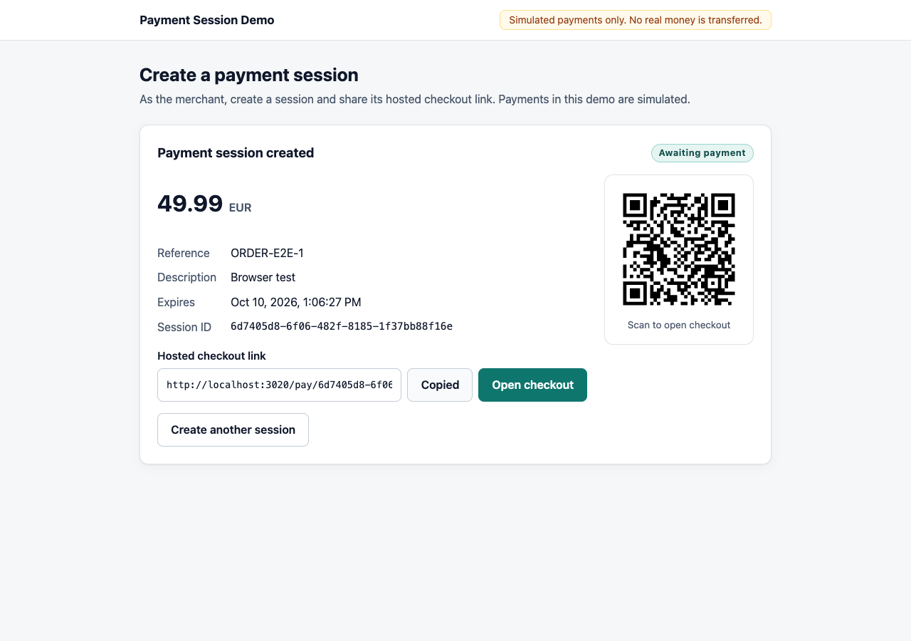
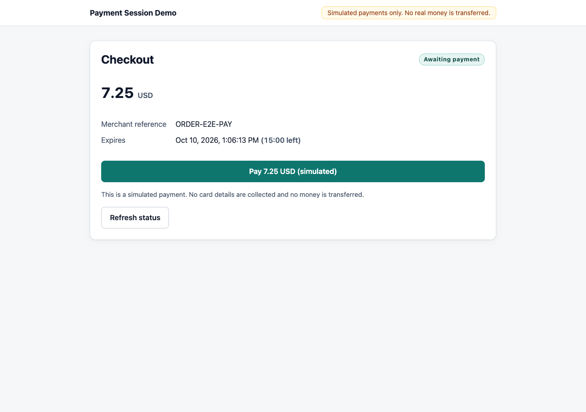
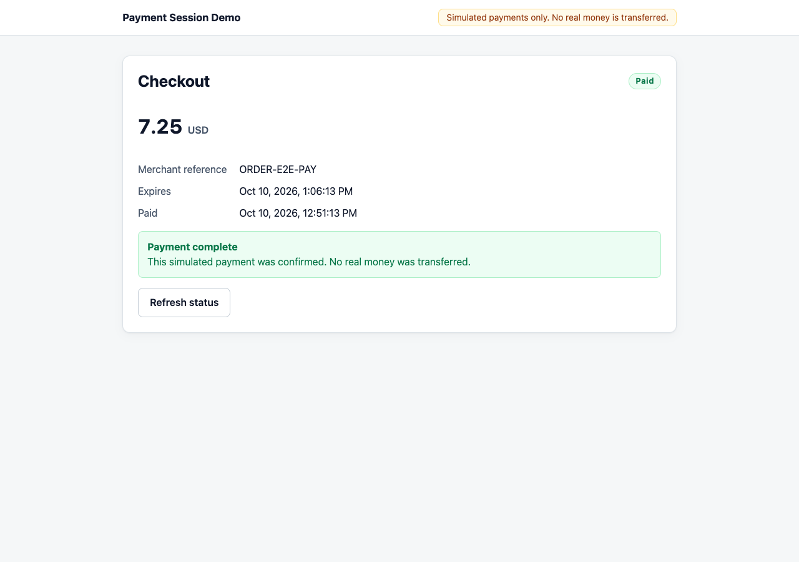
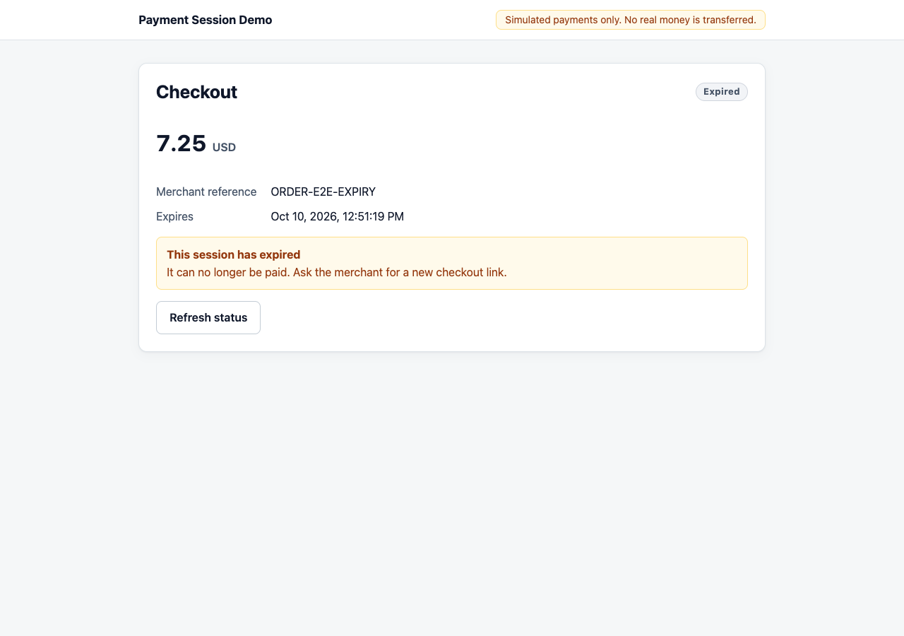
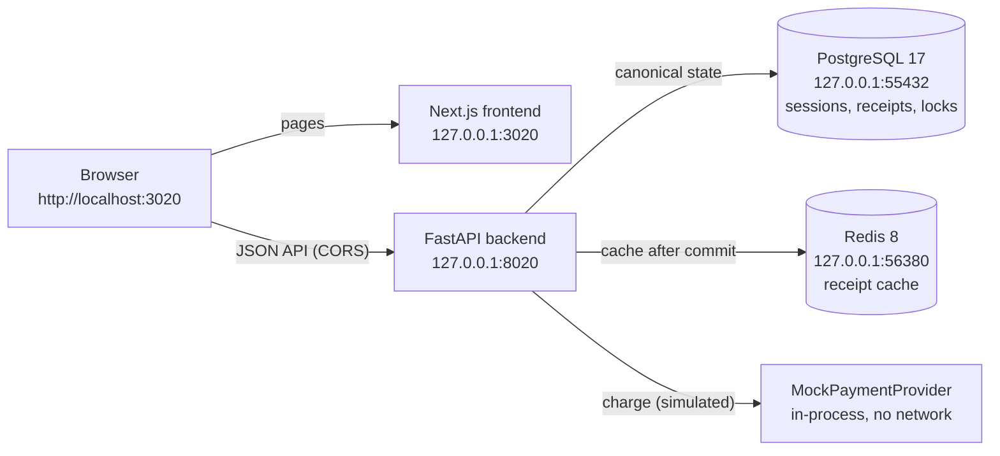
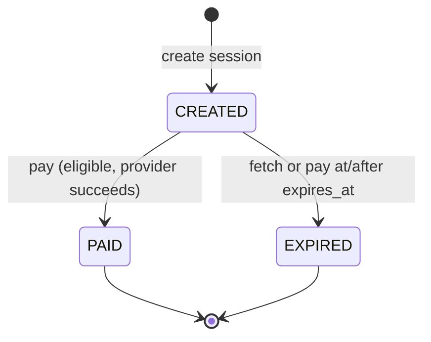

# Payment Session Service

> **Payments are simulated.** This project never collects card details, never
> contacts a payment network, and never moves money. A built-in mock provider
> stands in for a real payment processor.

A hosted-checkout payment-session service: a merchant creates a payment session,
shares a checkout link, and the payer completes a (simulated) payment. The focus is
on correctness under real-world failure modes — duplicate clicks, retries, lost
responses, concurrent tabs, expiry while paying, and cache or provider outages —
with PostgreSQL as the single source of truth.

## Workflow

1. **Merchant** opens `http://localhost:3020`, enters a reference, an amount, a
   currency, and an expiry, and creates a session.
2. The service returns a **hosted checkout link** (shown with a copy button and a
   locally generated QR code).
3. **Payer** opens the link (`/pay/<session id>`), sees the canonical amount and
   status, and clicks **Pay (simulated)**.
4. The backend moves the session `CREATED → PAID` once in PostgreSQL, stores a durable
   receipt, and returns the paid session. Retries replay that result instead of
   paying again. Sessions not paid in time become `EXPIRED`.

| Merchant form | Session created (link + QR) |
|---|---|
|  |  |

| Checkout awaiting payment | Payment confirmed | Session expired |
|---|---|---|
|  |  |  |

Mobile layout: [created session on a 390 px viewport](docs/screenshots/mobile-session-created.png).

## Stack and requirements

| Layer | Technology | Verified with |
|---|---|---|
| Backend | Python, FastAPI, Pydantic, SQLAlchemy 2, Alembic, psycopg 3, redis-py | Python 3.14.3; versions pinned in `backend/requirements.txt` |
| Database | PostgreSQL 17 (`postgres:17-alpine`) | via Docker Compose |
| Cache | Redis 8 (`redis:8-alpine`) | via Docker Compose |
| Frontend | Next.js 16 (App Router), React 19, TypeScript 5.9 | `frontend/package-lock.json` |
| Runtime | **Node.js 24 LTS**, npm 11 | Node 24.14.0, npm 11.9.0 |
| Tests | pytest; Playwright 1.64 with Google Chrome | — |
| Infrastructure | Docker with Compose v2 | Docker 29.5, Compose 5.1 |

Verified on macOS (Apple silicon). The setup steps below were run in the working
repository; a completely fresh clone on another machine has not been tested.

Local ports (all bound to `127.0.0.1`):

| Service | Port |
|---|---|
| PostgreSQL | 55432 |
| Redis | 56380 |
| FastAPI backend | 8020 |
| Next.js frontend | 3020 |

## Architecture



The browser talks to the API directly; the Next.js server only serves pages. Only
`NEXT_PUBLIC_API_BASE_URL` is exposed to the browser — database and Redis settings
never reach the frontend.

Backend layout (`backend/app/`): `api/` (routes), `services/` (payment and
idempotency logic), `repositories/` (SQL access, never commits), `models/`,
`schemas/`, `providers/` (provider interface + mock), `cache/`, `core/` (settings,
errors, request IDs, logging), `db/`. Migrations live in `backend/alembic/`.

## How it works

### Session states



`PAID` and `EXPIRED` are terminal; nothing returns to `CREATED`, and clients never
supply a status or timestamps. Money is handled as `Decimal` and stored as
`NUMERIC(12,2)`; the API sends and returns amounts as exact strings (`"49.99"`).
All timestamps are UTC.

### PostgreSQL: canonical state and durable receipts

- `payment_sessions` holds every session; database `CHECK` constraints enforce a
  positive amount, supported currencies (USD, EUR, GBP, INR), and valid statuses.
- `payment_receipts` stores one row per **successful** payment: the SHA-256 digest
  of the `Idempotency-Key` (unique), a fingerprint of the request (operation +
  session ID), the session ID (unique), and the exact `200` response body. The
  `PAID` update and its receipt are committed in the same transaction.

### Idempotency

`POST /api/sessions/{id}/pay` requires an `Idempotency-Key` (1–128 characters of
`A–Z a–z 0–9 . _ ~ : -`). Keys are **global to the pay operation**: one key
identifies one payment of one session.

| Request | Result |
|---|---|
| New key, eligible session | `200` — pays and stores a receipt |
| Same key, same session (retry) | `200` — identical body, `Idempotent-Replayed: true`, no second transition |
| Same key, different session | `409 IDEMPOTENCY_CONFLICT` — neither session changes |
| Different key, already-paid session | `409 SESSION_ALREADY_PAID` |
| Failed attempt (provider down, expired, invalid) | no receipt — the key is not consumed |

Raw keys are never stored or logged, only their digest.

### Locking and concurrency

Every pay runs in **one PostgreSQL transaction** and always takes locks in the same order:

1. `pg_advisory_xact_lock` derived from the key digest — serializes requests that
   share a key (a hash collision only makes two keys wait for each other).
2. Receipt lookup by full digest → replay or `IDEMPOTENCY_CONFLICT`, without
   touching any session.
3. `SELECT … FOR UPDATE` on the session row, then `clock_timestamp()` read under
   the lock, status and expiry checks, the provider call, a second clock read, an
   expiry re-check, and finally `PAID` + receipt.

`backend/tests/test_concurrency.py` proves this with independent connections and
committed data: two requests are released together and PostgreSQL itself reports
both blocked on the lock before they proceed (same key → one payment and identical
replies; different keys → one `200`, one `409`; one key on two sessions → one
success, one conflict).

### Redis: short-lived receipt cache

Redis caches **committed** successful receipts under
`payment-session-service:pay-receipt:<key digest>` for `RECEIPT_CACHE_TTL_SECONDS`
(default 600). It is written only after the PostgreSQL commit, replayed only when the
cached request fingerprint matches, and validated on read. A miss, an expired or
malformed entry, or any Redis error falls back to PostgreSQL; a failed cache write
never affects a committed payment. Redis is never used for locking.

The Redis client is configured to fail fast (no retries, 1 s connect/socket
timeouts), so an outage falls back to PostgreSQL quickly. `/health` still reports
`503` while Redis is down.

### Lazy expiration

There is no background job. A `CREATED` session whose `expires_at` has passed is
persisted as `EXPIRED` the next time it is fetched or paid:

- `GET` commits the expiration, then returns it.
- `POST /pay` commits the expiration, then returns `409 SESSION_EXPIRED`.
- If the deadline passes **while the provider call is in progress**, the second
  clock read catches it: the session becomes `EXPIRED`, no receipt is written, and
  the response is `409 SESSION_EXPIRED`.

Consequently, untouched sessions can remain `CREATED` in the database past
`expires_at`; anything reading the table directly must treat
`status = 'CREATED' AND expires_at <= now()` as expired.

### Provider failures

The provider is injected (`backend/app/providers/`), so tests substitute counting
and failing providers. It is called only for a new, eligible payment — never for
replays, conflicts, or unknown/`PAID`/`EXPIRED` sessions.

- **Known outage** → `503 PAYMENT_PROVIDER_UNAVAILABLE`; the session stays
  `CREATED` with unchanged timestamps, no receipt is stored, and the same key can be
  retried.
- **Unexpected provider error** → payment work is rolled back and a sanitized
  `500 INTERNAL_ERROR` is returned.
- To simulate an outage locally, start the backend with `ENABLE_MOCK_FAILURES=true`
  and send `X-Mock-Provider-Outcome: fail` (rejected with `422` when disabled).

### Checkout resilience (frontend)

- **Attempt key lifetime.** On the first Pay click, the checkout creates a UUID key
  and saves it in `sessionStorage` (`payment-session-service:v1:pay-key:<session id>`)
  *before* sending the request. Retries and reloads in the same tab reuse it; the
  entry is removed once the backend confirms `PAID` or `EXPIRED`. Closing the tab
  ends its lifetime. If storage is unavailable or full, a stable in-memory key is
  used for the page lifetime.
- **Lost responses.** A network failure or unexpected `5xx` does not prove the
  payment failed. The page re-fetches the session: `PAID` or `EXPIRED` is shown as
  such; if it is still `CREATED`, an explicit retry reuses the same key. If the
  status cannot be fetched either, Pay stays disabled ("payment status not
  confirmed") until a refresh succeeds.
- **Reconnects and stale tabs.** The page re-fetches on `online`, window `focus`,
  the tab becoming visible, and **Refresh status** (coalesced; no polling). A stale
  tab that tries to pay gets `409 SESSION_ALREADY_PAID` and refreshes. Payment
  requests are never retried automatically.
- **Ordering.** Older responses are cancelled or ignored, a `CREATED` snapshot
  never replaces `PAID`/`EXPIRED`, and recovery work is cancelled when the page
  navigates away.
- **Expiry countdown** is informational; at zero the page asks the server once, and
  only the server decides `EXPIRED`.

## API summary

| Method | Path | Purpose |
|---|---|---|
| `GET` | `/health` | `200` when PostgreSQL (`SELECT 1`) and Redis (`PING`) are reachable, otherwise `503` |
| `POST` | `/api/sessions` | Create a session → `201` with `checkout_url` |
| `GET` | `/api/sessions/{id}` | Canonical session (applies lazy expiration) |
| `POST` | `/api/sessions/{id}/pay` | Simulated payment; requires `Idempotency-Key` |

Errors share one shape — `{"error": {"code", "message", "request_id"}}` — and every
response carries `X-Request-ID`. Full contract, validation rules, and error codes:
[docs/api.md](docs/api.md). Design questions and answers:
[docs/interview-notes.md](docs/interview-notes.md).

## Setup

Prerequisites: Docker with Compose v2, Python 3.14 (`python3`), Node.js 24 with
npm 11, and Google Chrome (only for the browser tests). Commands below are run from
the repository root unless a `cd` is shown.

### 1. Configuration

There are two configuration files:

- **`.env` (repository root)** — read by Docker Compose *and* the backend (the
  backend locates it relative to its own source, so it works from any directory).
  Holds the PostgreSQL/Redis settings, CORS origin, checkout base URL, cache TTL,
  and `ENABLE_MOCK_FAILURES`. It is git-ignored.
- **`frontend/.env.local`** (optional) — only `NEXT_PUBLIC_API_BASE_URL`
  (default `http://127.0.0.1:8020`). `NEXT_PUBLIC_*` values are embedded at build
  time, so rebuild the frontend after changing it.

Create `.env` without overwriting an existing one:

```sh
cp -n .env.example .env
```

Then edit `.env` and replace the placeholder `POSTGRES_PASSWORD` with your own
value (for example, generate one with
`python3 -c 'import secrets; print(secrets.token_urlsafe(24))'`). Do this **before**
the first start: PostgreSQL sets the password when its data volume is first
created, and later edits to `.env` do not change an existing database's password.

### 2. Start PostgreSQL and Redis

Check that ports 55432 and 56380 are free (`lsof -nP -iTCP:55432 -sTCP:LISTEN`),
then:

```sh
docker compose -p payment-session-service up -d --wait postgres redis
docker compose -p payment-session-service ps
```

Data persists in the project's named volume `payment-session-service_postgres_data`.

### 3. Backend

```sh
python3 -m venv backend/.venv
backend/.venv/bin/pip install -r backend/requirements.txt
cd backend
.venv/bin/alembic upgrade head        # apply migrations
.venv/bin/alembic current             # expect: 0002 (head)
.venv/bin/uvicorn app.main:app --host 127.0.0.1 --port 8020
```

The application never creates tables at startup; schema changes go through Alembic
(`.venv/bin/alembic check` verifies models match migrations).

### 4. Frontend

Select Node 24 for this project without changing your global default — either
`nvm use` (reads `frontend/.nvmrc`) or prefix commands with an existing Node 24
install, e.g. `PATH=/path/to/node-v24/bin:$PATH`:

```sh
cd frontend
node --version                        # v24.x
npm ci
npm run dev                           # development server on 127.0.0.1:3020
# or a production build:
npm run build && npm run start
```

### 5. Use it

Open **http://localhost:3020**. Check health from another terminal:

```sh
curl -i http://127.0.0.1:8020/health
```

Notes:

- **Use `localhost`, not `127.0.0.1`, in the browser.** The backend's CORS policy
  allows exactly `http://localhost:3020` (`CORS_ORIGINS`), and checkout links use
  that origin (`FRONTEND_BASE_URL`).
- **QR codes work on this computer only.** They encode
  `http://localhost:3020/pay/…`; a phone scanning the code would resolve
  `localhost` to itself, not to this machine.

## Tests

Prerequisites: PostgreSQL and Redis running and healthy, migrations applied,
`backend/.venv` installed, and `npm ci` done in `frontend/` with Node 24.

### Backend

```sh
cd backend
.venv/bin/python -m pytest
```

- API tests use this project's real PostgreSQL; each runs in a transaction that is
  rolled back. The suite refuses to run unless the database is on a loopback host at
  port 55432 and at the expected migration revision.
- `tests/test_concurrency.py` runs committed transactions on independent connections
  (and real Redis) and deletes only the rows and exact cache keys each test created.
- `tests/test_dependency_outages.py` points the app at closed ports to check real
  outages: `/health` returns `503`, API calls return a sanitized
  `503 SERVICE_UNAVAILABLE`, and payments still work through PostgreSQL without Redis.
- One known warning is expected: `StarletteDeprecationWarning: Using httpx with
  starlette.testclient is deprecated; install httpx2 instead`.

### Frontend checks

```sh
cd frontend
npm run typecheck
npm run lint
npm run build
```

### Browser tests (Playwright)

```sh
cd frontend
npm run test:e2e                          # build, start servers, run all tests, stop servers
npm run test:e2e -- e2e/recovery.spec.ts  # pass Playwright arguments after --
E2E_SKIP_BUILD=1 npm run test:e2e         # reuse an existing production build
```

- The runner (`frontend/scripts/run-e2e.mjs`) **requires ports 8020 and 3020 to be
  free**. If either is in use it stops with a message; it never stops or reuses a
  server it did not start.
- It starts its own backend (with `ENABLE_MOCK_FAILURES=true` for that process only)
  and `next start`, and always stops exactly those processes afterwards, including
  when tests fail or on Ctrl-C.
- It uses installed **Google Chrome** by default. Without Chrome:
  `npx playwright install chromium`, then `E2E_BROWSER_CHANNEL=chromium npm run test:e2e`.
- Each test deletes only the sessions it created, their receipts, and their exact
  Redis keys (`backend/scripts/e2e_support.py`, which refuses anything but this
  project's loopback PostgreSQL and Redis). Nothing is truncated or flushed.
- Reports and artifacts are git-ignored: `frontend/test-results/`,
  `frontend/playwright-report/` (`npx playwright show-report`), and
  `frontend/e2e-artifacts/` (server logs and fresh screenshots).

## Configuration reference (`.env`)

| Variable | Default | Purpose |
|---|---|---|
| `POSTGRES_USER`, `POSTGRES_PASSWORD`, `POSTGRES_DB` | — (required) | Database credentials |
| `POSTGRES_HOST`, `POSTGRES_PORT` | `127.0.0.1`, `55432` | Backend → PostgreSQL; port is also the published host port |
| `REDIS_HOST`, `REDIS_PORT`, `REDIS_DB` | `127.0.0.1`, `56380`, `0` | Backend → Redis; port is also the published host port |
| `REDIS_KEY_PREFIX` | `payment-session-service` | Namespace for all Redis keys |
| `RECEIPT_CACHE_TTL_SECONDS` | `600` | Receipt cache lifetime |
| `CORS_ORIGINS` | `http://localhost:3020` | Allowed browser origins (comma-separated) |
| `FRONTEND_BASE_URL` | `http://localhost:3020` | Base of `checkout_url` |
| `ENABLE_MOCK_FAILURES` | `false` | Allow `X-Mock-Provider-Outcome: fail` |

## Stopping

Stop the backend and frontend with Ctrl-C in their terminals. Stop only this
project's containers, keeping all data:

```sh
docker compose -p payment-session-service stop   # stop containers
docker compose -p payment-session-service down   # remove containers and network; volumes are kept
```

Do not add `-v` unless you intend to delete this project's database volume, and do
not use `docker system prune`, `docker volume prune`, `killall`, or `pkill`.

## Limitations

- **Simulated provider only.** The `PAID` update and receipt are atomic in
  PostgreSQL because the mock has no external side effects. A real charge cannot
  join a database transaction; see "Provider limitation" in [docs/api.md](docs/api.md).
- **Lazy expiration.** Untouched sessions stay `CREATED` in the table after
  `expires_at` until read or paid.
- **Attempt keys are per tab.** They do not survive closing the tab; with the
  in-memory fallback, a reload starts a new key. The backend still prevents a
  second payment.
- **Local development setup.** No authentication, HTTPS, or deployment
  configuration; CORS and checkout links assume `localhost`.
- **Receipts are kept indefinitely**; there is no retention job.
- ESLint stays on 9.x until Next's lint plugins support ESLint 10, and the
  `httpx`/`httpx2` test warning is accepted rather than suppressed.

## Future improvements

- Real provider integration: record a pending attempt before calling out, pass the
  idempotency key to the provider, and reconcile provider records against receipts.
- Optional background expiry sweep (or expiry-aware queries) alongside lazy
  expiration.
- Merchant authentication and per-merchant idempotency-key scoping.
- Receipt retention policy and metrics/alerting on provider and cache failures.
- Configurable public base URL so checkout links and QR codes work across devices.
